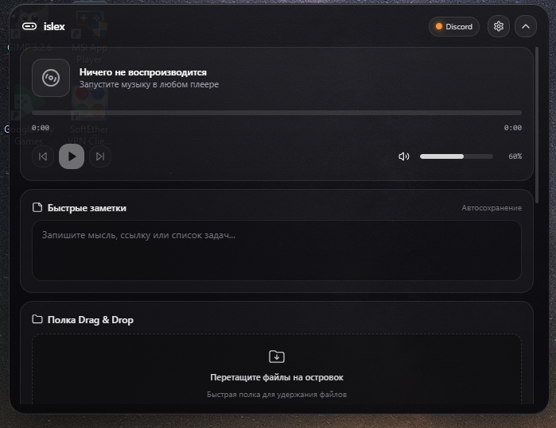
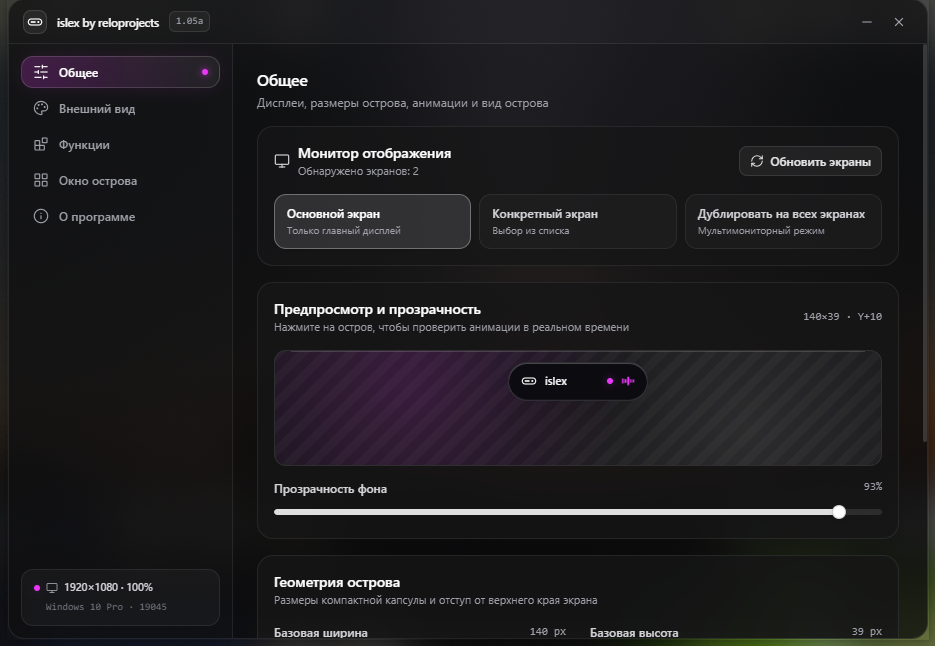

# islex

**A free Dynamic Island for Windows packed with useful features, created by ReloProjects\***

 

---

## ✨ What makes islex special?

* - **Minimal Resource Usage:** The core process consumes only **~15 MB of RAM** and near-zero CPU (often showing **0% CPU** usage in Task Manager).
* - **Mini-Mode:** Automatically collapses in any fullscreen app or game and only expands when you hold your cursor at the top edge for a couple of seconds—zero accidental clicks.
* - **Drag & Drop + Smart Clipboard:** Hold files directly inside the island using the built-in Drag & Drop shelf. The smart clipboard also includes a built-in calculator, instant translator, and a HEX color table.
* - **Deep Customization:** Extensive customization options for both the app behavior and the island's appearance (themes, materials, colors, animations).
* - **Music & Live Lyrics:** Synchronized lyrics powered by **LRCLIB**, automatically pulling currently playing tracks from any source (Yandex Music, Spotify, browsers, etc.).

 

  

---

## 📥 Download

Grab the latest portable `.exe` from [**GitHub**](https://github.com/cawiworld/islex/) or follow updates in our Telegram channel: [**@relobots**](https://t.me/relobots).
(updates come automatically)

---

*\*ReloProjects is a team of enthusiasts creating games and software across various genres. We strive to build free, fun, and useful things for our community.*
